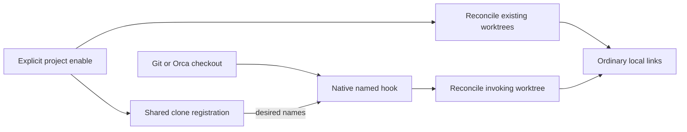

# Codex enablement across a clone's worktrees

Date: 2026-10-11
Status: Implemented; workstream closed by the operator on 2026-10-11
Workstream: `codex-project-enablement`

## Enable once, then discover the collection in every worktree

`skillset codex enable obra --project` registers the collection for one Git
clone, creates ordinary `.codex/skills/obra` links in its existing worktrees,
and configures a named `post-checkout` hook for future worktrees. Independent
clones of the same remote remain independent.

The operator accepted separate project scope, retaining `--local` and the
global default, and requiring Git 2.54+ for native config-based hooks. The
operator requested the simpler solution for existing local links. The operator accepted ordinary canonical links with no origin ledger:
project disable removes matching links, including ones enabled locally
beforehand (D3).

<a id="decisions-requiring-review"></a>

## Accepted design decisions

| ID | Status | Choice | Concrete cost | Contract |
| --- | --- | --- | --- | --- |
| D1 | Accepted | Add `--project`; preserve existing scopes and defaults | One additional scope flag | [CLI](#cli-scopes-remain-explicit) |
| D2 | Accepted | Require Git 2.54+ and use one shared native named hook | Project scope is unavailable with older Git | [Hook ownership](#native-hooks-preserve-existing-hook-ownership) |
| D3 | Accepted | Treat every matching link as an ordinary local link | Project disable also removes pre-existing local links | [Link semantics](#ordinary-links-have-no-origin-ledger) |
| D4 | Accepted | Store one shared names list for all harnesses in clone registration; use inherited HOME and PATH | Hook setup depends on the invoking environment | [Shared state](#one-registration-belongs-to-the-git-common-directory) |
| D5 | Accepted | Keep registration until disable finishes; recover by repeating commands | A failed disable can be undone by a later checkout while registration remains | [Recovery](#partial-operations-retain-registration-for-retry) |
| D6 | Accepted | Warn and return zero after ordinary hook failures | Failed setup can leave a worktree without skills | [Hook contract](#the-named-hook-reconciles-only-the-invoking-worktree) |
| D7 | Accepted | Summarize registration and current worktree presence with `[p]`/`[p-]`; reserve full health checking for `--project` | Overview checks current worktree links; redundant local rows are suppressed | [Listing](#project-list-reports-registration-and-reconciliation-errors) |
| D8 | Accepted | Do not index projects globally or extend collection lifecycle blockers | Users must disable project registrations before collection rename/removal | [Source lifecycle](#source-lifecycle-and-worktree-moves) |
| D9 | Accepted | Leave ignore rules under operator control | Generated links can appear as untracked files | [Ignored state](#generated-links-are-not-repository-content) |

Inherited requirements: clone-wide automation must include ordinary Orca
worktree creation without an Orca setup-script call; preserve unrelated
entries, hooks and `core.hooksPath`; use trusted-local-CLI reliability rather
than adversarial filesystem hardening. This specification records the
requested scope; [local CLI policy](../guides/local-cli-reliability.md)
governs failure handling.

## Registration and links have separate responsibilities



Registration records desired clone-wide enablement. The hook reads it;
ordinary links carry no separate scope or origin metadata.

The project infrastructure is harness-neutral: one shared names list, one
named Git hook and one internal dispatcher. Git discovery, persistence, hook
ownership and recovery belong to that shared layer. Harness-specific code
owns destination paths and link reconciliation. Current scope exposes project
operations only through Codex subcommands and reconciles only Codex links.
Later harness support will consume the same selection and hook, without
separate registrations or named hooks. No other harness integration or generic
plugin framework is implemented in this feature.


## Observable scenarios

Assume a healthy collection `obra` and worktrees A and B of one clone.

| Input or event | Result |
| --- | --- |
| Enable from `A/src` with `--project` | Register once; link at A's and B's worktree roots, not beneath `src` |
| Enable again from B | Reconcile missing links; preserve exact canonical links |
| Create C with ordinary `git worktree add` or Orca creation | Hook adds registered links in C before checkout returns |
| A already has a canonical local `obra` link | Enable accepts it; no origin information is recorded |
| Disable `obra --project` | Remove canonical `obra` links from A, B and C, including A's pre-existing link; remove registration for `obra` last |
| B has a real directory or different-target `obra` link during enable | Refuse before recording the requested change or changing links |
| B's `obra` was replaced with an unrelated entry before disable | Preserve that entry; remove other canonical links and registration |
| Enable encounters an ordinary I/O error after mutation starts | Exit 1; retain registration and completed links; repeat enable or disable |
| A locally disables a project-registered link | Local command succeeds as before; a later branch checkout or repeated project enable recreates it |
| Create C with `--no-checkout`, with no later checkout | No hook runs; repeat project enable to reconcile C |
| Run project scope outside a Git worktree | Exit 1 without creating managed state |
| Operate in a separate clone of the same remote | No effect on A, B or C |

## CLI scopes remain explicit

```sh
skillset codex enable NAME --project
skillset codex disable NAME --project
skillset codex list --project
skillset codex list --project --verbose
```

- `--project` has no short alias. It is mutually exclusive with `-g`/`--global`
  and `-l`/`--local` on Codex enable, disable and list. Conflicting flags are
  argparse usage errors, exit 2, before any mutation.
- Enable and disable retain global scope as their default. Unscoped list
  retains the global and exact-current-directory local views and adds enclosing
  clone registration with `[p]` markers.
- `--local` retains its exact current-directory behavior, including outside
  Git and beneath a worktree root. It does not resolve a repository root.
- Project scope resolves the enclosing Git worktree, including from a
  subdirectory or detached HEAD. A submodule is its own repository. A bare
  repository directory is refused; a linked non-bare worktree of a bare
  repository is supported, with the bare entry excluded from projection.
- Only project scope requires Git 2.54+. Explicit global/local scopes and other command groups acquire no new Git
  dependency or scope flags. Unscoped list opportunistically uses Git for
  registration discovery; it still works when Git is unavailable.
- Successful enable/disable remain silent and return 0. Operational errors
  use the existing `skillset: MESSAGE` convention and return 1. Ctrl+C in
  explicit commands retains the CLI's interrupt convention and exit 130.

## Ordinary links have no origin ledger

A projected entry is exactly the existing Codex collection link:

```text
<worktree>/.codex/skills/<name>
  -> <current-home>/.agents/skillsets/<name>/skills
```

Use the existing absolute-target comparison: an absolute target whose
normalized spelling equals the expected target is canonical. A relative link,
different target, directory or regular file is unrelated. Containers must be
real directories, as in the existing Codex implementation.

Enable accepts a canonical entry without replacing it, and creates a missing
entry. Disable removes a canonical entry without requiring the target to
exist. It preserves unrelated entries and regards absent/unrelated entries as
already cleared for that name. It never removes `.codex` or `skills` containers.
Only named links at registered worktree roots are covered; nested local links
are outside project scope.

A provenance ledger could preserve local enablement during project disable,
but would add per-worktree bookkeeping, move handling and rules for changing
ownership through local commands. The recommended ordinary-link model matches
the operator's request for simplicity. Its cost is deliberate: to keep a local
link after project disable, run local enable again afterward. Local commands
retain their existing semantics and do not edit project registration.

## One registration belongs to the Git common directory

Use Git, rather than remote URL or primary-checkout path, to discover identity:

```text
git rev-parse --path-format=absolute --git-common-dir
git rev-parse --show-toplevel
git worktree list --porcelain -z
```

Resolve the common directory to a normalized absolute path. Parse NUL-separated
worktree records, exclude bare records, and process paths in deterministic
lexicographic order. Confirm each accessible worktree resolves to the same
common directory before projecting into it. When inspecting another worktree,
clear repository-location environment variables reported by
`git rev-parse --local-env-vars` in that child environment, then use `git -C`.
Do not clear the caller's environment globally. Git documents shared config
and worktree inventory in the [worktree manual](https://git-scm.com/docs/git-worktree);
the [hook manual](https://git-scm.com/docs/githooks) documents clearing repository
environment when inspecting a different worktree.

Inventory includes non-bare locked and detached worktrees. A missing,
inaccessible or mismatched registered worktree is an explicit reconciliation
error; do not prune or unlock it automatically. The operator restores it or
uses Git's worktree maintenance commands before retrying. No worktree-path
cache is needed; Git's current worktree inventory remains authoritative.

The single new persistent file is harness-neutral; this feature only implements
Codex project enablement:

```text
<git-common-dir>/project-skillsets.json
```

Example schema, containing exactly these keys:

```json
{
  "version": 1,
  "names": ["obra", "personal"]
}
```

- `version` is integer 1. `names` is a nonempty, sorted list of unique valid
  skillset names. The top-level keys are exactly `version` and `names`. Do not
  store home, executable, active set or upstream lock data.
- The list is shared across harnesses, not keyed by harness. Current product
  functionality consumes it only through Codex project subcommands; future
  harness implementations will use this same selection. This feature adds no
  project commands, links or hooks for other harnesses.
- Commands resolve collections using their normal inherited home. Targets keep
  the stable `.agents/skillsets` spelling, including when configured storage
  lives elsewhere. The hook resolves `skillset` through standard `PATH` precedence.
- The operator rejected persistent home/executable binding: changing `HOME` and
  sharing one clone between users are outside the intended workflow. Recording
  names is sufficient for that workflow and avoids executable migration rules.
  Environment changes are not detected or migrated; existing absolute links
  continue to be compared against the current home's expected targets.
- The file must be a real regular UTF-8 JSON file. Malformed or unsupported
  state is refused unchanged, with its path and reason. Missing state is
  unregistered. Empty state is not a supported on-disk schema.
- Write with a same-directory temporary file and atomic replacement. Clean up
  the temporary file after ordinary write failures. This is serial reliability,
  not a new journal or adversarial staging protocol.

Keeping registration and hook config with the clone means removing the clone
also removes its registration. A global project index would create another
source of truth and stale-path maintenance; it is excluded by D8. Existing
runtime roots, aliases, upstream metadata and locks under `~/.agents` remain
unchanged. All project commands and the internal hook reuse the stable home
lock and non-creating discovery lock path. They do not create a missing `.agents` root
or advisory lock merely to discover Git or clean up project links. Enable
still requires a valid managed layout; list and disable can diagnose or clean
up links when a registered inactive source is absent. Concurrent mutation
remains best effort.

## Native hooks preserve existing hook ownership

The command owns only these two keys in the common repository config:

```text
hook.skillset-project.command
hook.skillset-project.event = post-checkout
```

Use Git config commands with explicit repository-local scope, not a text
rewrite of config. The stored command is a fixed shell wrapper using inherited `HOME` and `PATH`. No hook file, `core.hooksPath`, other named
hook, worktree-specific config or global Git config is modified.

Preflight checks all occurrences and effective values of the reserved hook
subsection in the invoking and other accessible worktrees. Without valid
registration, any reserved subsection is a conflict. With registration, owned
keys may be missing after interruption or match the generated command and
single event; additional keys, duplicate values, inherited occurrences or
changed values are refused. Do not silently overwrite external edits. A
missing command key or event key is owned recovery state only while valid
registration exists. Inherited or worktree-specific settings that disable this named hook are also refused
for enable and reported by list; disable may clean up owned local keys while
preserving those settings. Inspect effective hook listing and supported
enabled controls, including event-wide disabling on Git versions that support
it; key presence alone does not prove the hook is enabled. Do not write these
controls. Future configuration overrides cannot be prevented; project list is
the diagnostic path.

Read-only inspection found GitButler owns this repository's traditional
`post-checkout` file and can restore or remove it. Git's native named hook runs
before the traditional hook and has a separate lifecycle, avoiding a wrapper
whose file another manager may rewrite. The alternative file-hook integration
would support older Git at the cost of separate chaining and uninstall rules;
the operator explicitly accepted D2 instead.

Evidence: [Git 2.54 release notes](https://github.com/git/git/blob/v2.54.0/Documentation/RelNotes/2.54.0.adoc)
introduce config-based hooks; the [2.54 hook manual](https://git-scm.com/docs/git-hook/2.54.0)
defines named hook commands and traditional-hook ordering. Installed Git is
2.56.0. [Compatibility research](../research/codex-worktree-hook-compatibility.md)
records the existing hook and Orca probe. Native-hook coexistence has not yet
been runtime-tested.

## The named hook reconciles only the invoking worktree

Add a hidden top-level command `skillset _project-hook` taking Git's old HEAD,
new HEAD and checkout flag. It is omitted from user help and completion. It has no
scope/name flags and is not a supported user entry point.

The configured shell command invokes `skillset` through standard `PATH`
precedence, inherits `HOME`, forwards the three arguments and returns zero
after any ordinary invocation failure. Use a shell function so Git's appended
arguments reach the invocation. A representative template is:

```sh
skillset_project_hook() {
  if skillset _project-hook "$@"; then
    :
  else
    printf '%s\n' 'skillset: project hook failed; rerun project enable or inspect project list' >&2
  fi
  return 0
}; skillset_project_hook
```

Generate one shell line for Git config; pass that line as one subprocess
argument. The template is illustrative; the quoting, forwarding and zero-exit
behavior are normative. The internal command reports its own detailed errors;
the wrapper also covers a missing executable or failure before CLI startup.
This adds no persistent launcher file.

- Flag 0 (file checkout) does nothing. Flag 1 reconciles all registered names
  at this worktree root. Malformed arguments report an error without mutation.
- Discover the common directory afresh; do not embed its absolute path in the
  hook command. Missing registration is a quiet no-op. Unsupported state is
  reported and preserved.
- Use the inherited home, validate each registered source independently and
  preserve existing canonical links. Missing/invalid sources produce errors
  without creating new dangling links; other valid names still reconcile.
- The shared dispatcher invokes the supported harness reconciler for this
  worktree; currently this is Codex only. Future harness implementations reuse
  this dispatcher and shared selection, rather than adding harness-specific
  Git hook keys or entry points.
- Reconcile only this worktree, not every worktree. It must not invoke Git
  checkout or recurse into its own hook. It never changes registration/config.
- Normal success has no output. Detailed failures go to stderr, never stdout;
  the wrapper returns 0 so skillset failure does not alter Git's exit status.
  This does not suppress another hook's failure or promise recovery from a
  killed process, unavailable shell, or invalid externally edited Git config.
- No Orca setup script or Orca-specific product code is involved.

The hook environment must provide `skillset`, Python 3 and Git through `PATH`.
A different `skillset` installation earlier in `PATH` is used normally. Moving
an installation needs no registration update if `PATH` still resolves it.
A missing executable produces the wrapper warning; environment repair followed
by checkout or repeated project enable is the recovery path. No self-contained
copy of the implementation is installed in Git metadata.

Git documents that branch checkout, switch and ordinary worktree add trigger
`post-checkout`; bare `--no-checkout` creation does not. The installed Orca
1.4.223 probe verified the trigger with setup scripts skipped, using a
traditional hook, not this implementation. Sparse/prepared Orca paths have
source evidence only. Remote Linux hosts need their own installation and Git
version; SSH/WSL execution is not yet verified.

## Partial operations retain registration for retry

### Enable records intent before creating links

1. Validate Git version, worktree identity, managed layout, requested source,
   existing registration and hook ownership. Build the desired name union.
2. Preflight every desired source, worktree and destination. A known collision
   or missing worktree refuses the requested change before mutation.
3. Atomically write registration containing the desired name union.
4. Install/reconcile the owned command key, then the event key.
5. Reconcile desired links across existing worktrees. Continue across ordinary
   per-worktree errors to report every affected path; return 1 if any fail.

After step 3, a failure leaves the recorded name union and completed changes
in place. Repeat enable to finish; disable can cancel a recorded name. There is
no all-worktree rollback, copied link tree, or per-link ownership record. A
repeated enable also repairs missing owned hook keys, while changed/unrelated
keys remain conflicts.

### Disable removes registration last

1. Require valid registration containing NAME; do not require that
   collection still exists. Preflight inventory, container shapes and owned
   config before mutation. Missing registered worktrees are errors.
2. If NAME is the last registration, remove the owned event key before link
   cleanup so ordinary later checkout will not immediately recreate links.
   Remove the owned command key next. Missing owned keys are acceptable.
3. Remove canonical links for NAME from all registered non-bare worktrees.
   Continue across ordinary unlink errors; preserve unrelated entries.
4. Only after successful cleanup, atomically remove NAME from registration,
   or unlink the registration file when no names remain.

Failure retains NAME in registration. Other names and links are unaffected.
When disabling the last name, a failure may leave the hook absent while the
registration remains. Repeat disable to finish or enable to restore the hook
and links. When other names remain, their hook stays installed; a later
checkout can recreate NAME until disable succeeds. This is an explicit failed
operation, not successful disable. A removal-intent journal would avoid that
window but adds a second registration state; D5 chooses retry simplicity.

If NAME is not registered, disable returns 1 without removing arbitrary local
links. Successful disable is not idempotent, matching existing disable behavior.
For externally edited reserved hook config, restore the recorded owned values
or remove conflicting settings deliberately before retrying; the CLI never
removes an unrelated command merely to finish cleanup.

## Project list reports registration and reconciliation errors

Unscoped `codex list` renders global, project and local groups in that order,
with names sorted within each group. Project rows use `[p]` for a registered
name with a canonical link at the current worktree root, and `[p-]` when that
link is absent or unrelated. Both markers are orange on a color-enabled terminal.
Local rows use `[l]` for canonical links in the exact current directory whose
names are not registered. Explicit `--local` retains all canonical local links.
From a subdirectory, project presence still uses the enclosing worktree root.
Local disable changes `[p]` to `[p-]`, retaining registration; absence alone is
not an overview error. A subsequent branch checkout or repeated enable can
recreate the link. No persistent worktree exclusion state is introduced.

The operator approved this D7 revision on 2026-10-11 to reduce confusing
duplicate rows. It supersedes the original presentation of separate `[p]` and
`[l]` rows for a registered local link; registration and physical links retain
their separate responsibilities.

Revision verification: `python3 -m unittest discover -s tests -q` passed all
333 tests on Python 3.14.8 / Git 2.56.0. Focused coverage includes local
disable, independent linked-worktree presence, subdirectory listing, explicit
local filtering, read-only snapshots and plain/verbose orange markers.
Direct renderer checks cover both project markers with invalid-source fallback,
pipes, `NO_COLOR` and `TERM=dumb`. These checks do not extend the original
Git-version or Orca acceptance evidence.

Retain manual markers and verbose inventory conventions for all groups;
invalid registered sources remain visible with the same invalid annotations
as project-only listing.

Discover project registration read-only when Git is available and the current
directory belongs to a non-bare worktree. Outside Git, in a bare directory or
without Git, omit the project group and preserve existing listing behavior.
This overview reads registration, source inventory and canonical-link presence
at the invoking worktree root; it does not inspect all worktrees or effective
hook health. Ordinary link-inspection errors are reported with exit 1.
Malformed/unreadable registration is reported with exit 1 after rendering
available global/local rows. Full project health inspection remains explicit
through `--project`.

`codex list --project` is read-only and does not install hooks or repair links.
No registration and no reserved hook config produces empty stdout and exit 0.
Orphan reserved config or malformed state produces an error and exit 1.

For valid registration, print sorted registered names without scope/active
markers, retaining `[m]` for healthy manual collections. Missing or invalid
sources remain visible as `NAME [invalid: REASON]`. Verbose output uses the
existing inventory table conventions; an uninspectable source has an invalid
annotation in its SKILLS cell. Healthy sources retain normal skill inventory
and TTY styling. No new status table is needed. Unscoped `[p]` uses the existing scoped rendering
with a textual marker; global/local styling retains its existing meaning.

After rendering registration, check every source, the effective hook and all
registered worktree projections. Report each problem on stderr and return 1
when any exist. A locally deleted link is incomplete while project registration
remains. Unrelated destination entries are conflicts. Collection metadata
inventory annotations retain their existing meaning; only errors preventing
source/project reconciliation make this command fail. A dangling canonical
link cannot make a missing source appear healthy.

Representative stable diagnostic messages, with paths/reasons appended where
applicable, are:

```text
skillset: project scope requires Git 2.54 or newer
skillset: project scope requires a Git worktree
skillset: invalid project registration PATH: REASON
skillset: project hook configuration conflicts: KEY
skillset: project hook is incomplete; rerun project enable
skillset: cannot inspect registered worktree PATH: REASON
skillset: Codex skillset entry already exists: PATH
skillset: project link is missing: PATH
skillset: skillset is not project-enabled: 'NAME'
```

Reuse terminal-safe escaping for paths and errors. Do not hide desired names
merely because projection or source health is incomplete. Existing global and
local list semantics remain unchanged.

## Source lifecycle and worktree moves

Project registrations are not globally indexed. Existing global Codex,
Claude and Auggie lifecycle blockers remain unchanged. Before renaming or
removing a project-enabled collection, disable it in every known registered
clone. Running lifecycle commands from another directory cannot promise to
find those clones, just as existing local links are not indexed.

If a source is moved or removed externally, project list reports it and the
hook skips creating new links for it. Disable remains able to clean canonical
dangling links. Do not silently rename registration or delete unrelated links.

`git worktree move` preserves the ordinary projected links; no cached path must
be migrated. Git's inventory must be repaired using Git when a worktree is moved
manually. `git worktree remove` removes its links with the checkout. The next
inventory excludes removed/pruned entries. Moving the clone does not invalidate
the generated hook command because it embeds no filesystem paths. Home changes are outside the intended
workflow; no automatic rewriting of existing absolute link targets is provided.

## Generated links are not repository content

Do not modify `.gitignore`, shared `info/exclude`, or global ignore settings.
Automatic per-name excludes would require another ownership/cleanup mechanism;
ignoring all `.codex` content could conceal intentionally committed skills.
The README must explain that these absolute machine-specific links are
uncommitted runtime state. If desired, add narrow rules such as
`/.codex/skills/obra` to clone-local `info/exclude` instead of ignoring all
hand-authored content. Find that file with
`git rev-parse --git-path info/exclude`.

Tracked or unrelated destination entries are never overwritten by enable.
As ordinary local links have no provenance, a tracked canonical link is
indistinguishable by target and is removed by project disable; document that
generated canonical links must not be committed. This design does not add an
index inspection subsystem to reinterpret existing canonical-link ownership.

## Implementation boundaries and compatibility

Observed baseline: Linux-only Python 3 standard-library CLI; upstream-managed
and manual collections share `skills/`; configured storage is exposed through
`~/.agents/skillsets`. Installed `skillset` resolves to this repository's
`bin/skillset`. GitButler is initialized; the inspected upstream base is
`bb7e9152fe6c9f7976586380cd2956b9bf6e92c1`. No product implementation exists.

| Owner | Responsibility |
| --- | --- |
| `lib/skillset/codex.py` | Codex destination/container/canonical-link reconciliation at an explicit worktree root; preserve existing scopes and bridge Codex project commands to the shared layer |
| New `lib/skillset/project.py` | Shared Git discovery, registration validation/writes, named hook ownership, operation/recovery ordering and hook dispatch; call the current Codex reconciler |
| `lib/skillset/cli.py` | Codex-only public scope flag, hidden top-level hook parsing, dispatch and existing lock/error conventions |
| `lib/skillset/completions.py` | `--project` in Bash, Zsh and Fish; scope mutual exclusion; no internal-hook completion |
| `lib/skillset/metadata.py` | Reuse rendering; narrowly support registered names whose source cannot be inspected |
| `tests/test_skillset.py` | Isolated CLI contracts and real Git/hook process tests |
| `README.md` | Scope examples, disable consequence, repeat-command recovery, dependencies and ignore guidance |

Project parsing/discovery must run through the non-creating lock path before
any mutation; a non-Git invocation cannot initialize `.agents` as a side
effect. Do not refactor unrelated integrations. There is no automatic migration
of existing local links or registration: project enable is the explicit opt-in.
No active-set changes, upstream `skills` calls, Orca setup configuration,
global project index, persistent hook launcher, watcher, or adversarial
filesystem protocol is introduced.

## Acceptance evidence required before implementation completion

Use isolated temporary homes and clones, never live runtime layouts. Apply
[in-process/subprocess test selection](../guides/in-process-cli-test-selection.md):
ordinary validation can run in-process; Git-triggered behavior, environment
lookup and shell forwarding need real processes.

1. Existing global/local Codex behavior and scope defaults remain covered,
   including exact-directory local behavior and non-Git use. Unscoped listing
   covers global/project/local ordering, redundant-local suppression, local
   disable yielding `[p-]`, worktree-root presence from subdirectories and
   operation without Git. Codex-only scope
   conflict/usage tests and all three completion grammars cover `--project`.
2. Real Git tests cover main and linked worktrees, subdirectory invocation,
   detached HEAD, a bare common repository with non-bare linked worktrees,
   multiple collections and independent clones.
3. Canonical pre-existing links are accepted and removed by project disable;
   different-target entries survive. Enable preflights all worktrees before a
   collision can record new intent. Missing sources remain list-visible and
   can be disabled; hook processing continues for other valid sources.
4. Native hooks run during ordinary worktree add and later checkout after
   `--no-checkout`. Verify all three forwarded arguments, no-op file checkout,
   standard PATH precedence between installations, inherited temporary HOME,
   and worktree/home/PATH entries with spaces and shell metacharacters. Missing executable and ordinary reconciliation errors
   return zero to Git with stderr evidence; another hook's status is preserved.
5. Existing traditional hooks and configured `core.hooksPath` retain their
   files, values, invocation and arguments. Include the inspected GitButler
   restoration/removal lifecycle in a disposable reproduction. Effective named
   hook conflicts, disabled hooks and interrupted/missing owned keys are
   diagnosed without overwriting unrelated config.
6. Ordinary registry/config/link failures and Ctrl+C retain the documented
   repeat-enable/disable recovery paths. Include partial last-name disable and
   partial disable with another registered name still active. No concurrency
   timing matrix or syscall fault-injection suite is required.
7. Move/remove worktrees and move a clone; verify dynamic inventory and absence
   of embedded common-directory paths. Missing/inaccessible registered
   worktrees produce actionable errors rather than successful reconciliation.
8. Validate harness-neutral file/config keys and the hidden top-level hook
   entry point, without adding public project flags or side effects to other
   harnesses. Validate the shared names-only schema, including
   last-name cleanup deleting the registration file. Verify read-only project
   list, invalid source rendering, no Git
   dependency added to explicit existing scopes, no ignore-file changes, and no
   mutations of unrelated runtime metadata. Compare directory/config snapshots
   where preservation is the assertion.
9. Run focused tests, then `python3 -m unittest discover -s tests -v`. Search
   implementation-facing files for leaked planning terminology. Runtime
   native-hook verification with installed Orca remains an acceptance check;
   use disposable resources and the existing research reproduction, not this
   repository's live hooks. Sparse/prepared/remote paths remain explicitly
   unverified unless separately exercised.

Design evidence so far is repository/source inspection and the prior Orca
trigger probe. No product tests or native-hook runtime probe have been run in
this design session. The minimum-version contract must be checked against
Git 2.54 documentation/tests, without depending on newer hook controls.

## Approval and closure

The operator approved this design after individual review of D1–D9 and the
subsequent harness-neutral naming and listing-order revisions, then approved
the implementation plan. The completed plan was retired after its durable
findings were preserved in this specification, tests and compatibility research.
Implementation and verification followed the clean-session boundary.

The operator closed the workstream on 2026-10-11 and removed the HTML review
companion. This Markdown specification remains authoritative. The
[compatibility research](../research/codex-worktree-hook-compatibility.md)
retains verification evidence and limits, including the unverified unmodified
Orca service environment. Closure does not establish additional runtime
coverage or authorize pushing, merging or live hook installation.
